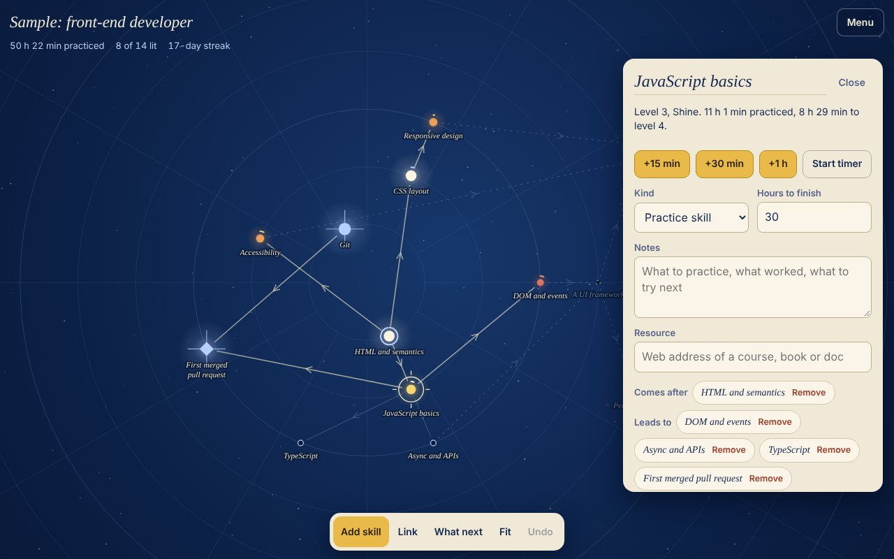
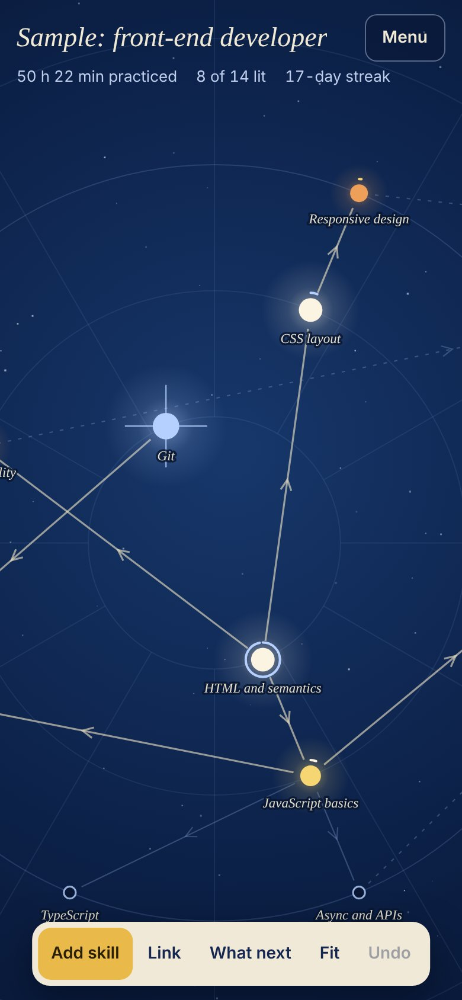

# Constellate

A skill tree for your real life, drawn as a night sky.

Each skill is a star. Log practice and the star burns hotter: red, orange, yellow, white, then blue-white, the same order real stars follow as they get hotter. Bright stars open the ones beyond them, so the chart always shows what you can work on next.

It runs entirely in your browser. No account, no server, no tracking, no dependencies.





## Use it

**Quickest:** download [`dist/constellate.html`](dist/constellate.html) and open it. It is the whole app in one file and works offline.

**From the repository:**

```sh
node scripts/serve.mjs      # then open http://127.0.0.1:4173
```

Node.js 20 or newer is the only requirement. There is nothing to install.

## What you can do

| | |
|---|---|
| Map skills | Double-tap the sky or choose **Add skill**. Drag stars anywhere. Pinch or scroll to zoom. |
| Link them | **Link**, then tap the skill that comes first and the skill it leads to. Loops are refused. |
| Log practice | Tap a star, then **+15 min**, **+30 min**, **+1 h**, or run the timer. |
| Milestones | One-off achievements such as "First merged pull request". Mark them done. |
| Decide what to do | **What next** ranks open skills by what they unlock and shows 12 weeks of activity. |
| Start fast | Templates for a front-end developer, a new engineering manager, Spanish and a first marathon. |
| Keep it private | Lock the chart with a passphrase. It is encrypted before it is saved. |
| Take it with you | Export and import backups, plain or encrypted. Save a picture of the chart. |
| Recover | Undo and redo cover every change, including imports and new charts. |

### Levels

A skill has a target in hours (20 by default). Levels arrive at 5, 15, 35, 65 and 100 percent of the target, so the first hour visibly lights the star.

| Level | Name | Star |
|---|---|---|
| 0 | Unlit | hollow ring |
| 1 | Ember | red |
| 2 | Glow | orange |
| 3 | Shine | yellow |
| 4 | Bright | white |
| 5 | Brilliant | blue-white, with spikes |

A skill opens the ones after it when it reaches level 2. A milestone opens them when it is done. Locked skills are a guide, not a wall: you can still log time on them.

### Shortcuts

`N` add a skill, `L` link, `F` fit the chart, `Delete` remove the selected skill, `Ctrl`/`Cmd`+`Z` undo, `Shift` with it to redo, arrow keys pan. **Menu → All skills** is a keyboard and screen-reader view of the chart.

## Privacy and security

- **No network.** The app makes no requests and loads nothing from other sites. A Content-Security-Policy with `default-src 'none'` and `connect-src 'none'` makes the browser enforce that.
- **Local data.** Your chart lives in this browser's storage. Clearing site data removes it, so export a backup now and then.
- **Encryption.** A passphrase encrypts the chart with AES-256-GCM. The key comes from PBKDF2-SHA-256 with 600,000 iterations, is not extractable, and exists only in memory while the page is open. There is no reset: a forgotten passphrase means the chart cannot be recovered.
- **Untrusted input.** Imported files are rebuilt field by field. Text is never rendered as markup, and only `http` and `https` links are kept.
- **No supply chain.** Zero runtime dependencies, zero build dependencies, and a CI workflow that uses no marketplace actions.

The full threat model, the repository hardening and the limits of all this are in [SECURITY.md](SECURITY.md).

## Harden your own copy

If you fork or copy Constellate into your own GitHub repository, this applies recommended security settings and prints an audit:

```sh
./scripts/harden-repo.sh [owner/repo]
```

It turns on Dependabot, locks down Actions, enables secret scanning and branch protection where your plan includes them, and never changes the repository's visibility. Run it again at any time for a fresh audit.

## Develop

```sh
npm test                         # unit tests (node --test)
npm run build                    # rebuild dist/constellate.html
npm run check                    # tests + build check + security policy check
git config core.hooksPath .githooks   # enable the pre-commit checks, once per clone
```

```
index.html, styles.css   the page
src/core/                model, levels, layout, encryption, templates (no DOM, fully tested)
src/ui/                  canvas renderer and the app
scripts/                 build, local server, security check, GitHub setup
test/                    unit tests
dist/constellate.html    the single-file build
```

`dist/constellate.html` is committed so it can be downloaded directly. CI fails if it does not match the source.

## License

[MIT](LICENSE)
